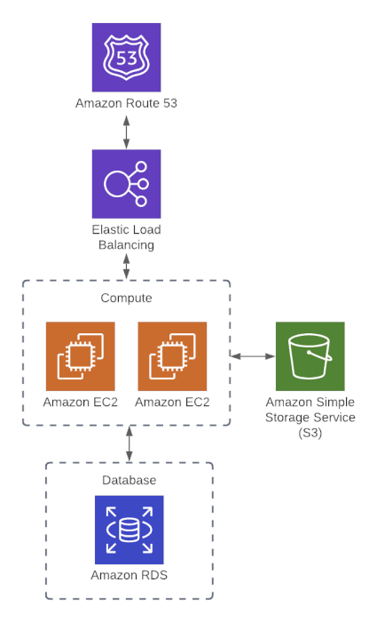

# Web-App — הסבר על הארכיטקטורה המלאה

זה לא משאב בודד — זו **ארכיטקטורת web app אמיתית** עם כמה "שכבות" שמתחברות זו לזו.

## זרימת התנועה (Traffic Flow) — התמונה הגדולה

```
משתמש בדפדפן
    ↓
Route 53 (DNS)  →  מתרגם domain name ל-IP של ה-Load Balancer
    ↓
Application Load Balancer (ALB)  →  מקבל תעבורה בפורט 80
    ↓
Target Group  →  מחליט לאיזה EC2 instance להעביר את הבקשה
    ↓
EC2 instance_1 / instance_2  →  מריצים שרת פייתון בפורט 8080 שמחזיר "Hello World"
```

בנוסף, יש **S3 bucket** (לאחסון קבצים של האפליקציה) ו-**RDS database** (לנתונים) — קיימים "בצד", לא מחוברים אוטומטית בקוד לבקשת ה-HTTP, אבל זו התשתית שאפליקציה אמיתית הייתה משתמשת בה.

## שכבה 1: Compute — `aws_instance` (instance_1, instance_2)

שני שרתים זהים (**redundancy** — אם אחד נופל, השני ממשיך לענות). שימו לב ל-`user_data`:
```bash
#!/bin/bash
echo "Hello, World 1" > index.html
python3 -m http.server 8080 &
```
זה סקריפט שרץ **אוטומטית בהפעלה הראשונה** של המכונה (cloud-init) — יוצר עמוד HTML ומרים שרת HTTP זמני בפורט 8080. זו הסיבה שהם "מדברים" בפורט 8080, לא 80 הרגיל.

## שכבה 2: Storage — `aws_s3_bucket` + versioning + encryption

זהה ברעיון למה שראינו ב-`aws-backend`, אבל כאן זה **לא לאחסון state** — זה bucket כללי לנתוני האפליקציה עצמה (למשל uploads של משתמשים). שימו לב ל-`bucket_prefix` במקום `bucket` — זה נותן ל-AWS לייצר שם ייחודי אוטומטית (עם prefix שביקשתם), כדי לא להתנגש בבעיית "שם גלובלי תפוס" שנתקלנו בה ב-`aws-backend`.

## שכבה 3: Networking — `data` blocks + Security Groups

כאן מופיע משהו חדש: **`data` blocks**:
```hcl
data "aws_vpc" "default_vpc" { default = true }
data "aws_subnet_ids" "default_subnet" { vpc_id = ... }
```
בניגוד ל-`resource` (שיוצר משהו חדש), **`data` "שואל" את AWS** — "תביא לי מידע על ה-VPC ברירת המחדל שכבר קיים בחשבון שלי". לא יוצרים כלום, רק קוראים מידע קיים כדי להשתמש בו (כאן: כדי לדעת לאיזה subnets לחבר את ה-Load Balancer).

💡 זה concept שעוד לא כוסה רשמית בסילבוס (מגיע רק במודול 06) — שווה להזכיר בקצרה בשיעור בלי להיכנס לעומק כרגע.

**שני Security Groups נפרדים** — למה שניים ולא אחד?
- `instances` SG — מרשה כניסה לפורט **8080** (איפה שה-EC2 מקשיב)
- `alb` SG — מרשה כניסה לפורט **80** (איפה שהמשתמשים מגיעים מבחוץ) + כל יציאה (`egress`)

זה **defense in depth**: ה-EC2 instances לא חשופים ישירות לאינטרנט בפורט 80 — רק ה-ALB חשוף, וממנו התעבורה "קופצת" פנימה לפורט 8080 של המכונות.

## שכבה 4: Load Balancing — `aws_lb` + `listener` + `target_group`

- **`aws_lb_target_group`** — קבוצת "יעדים" (ה-2 instances) + **health check**: כל 15 שניות בודק אם `/` מחזיר סטטוס 200. אם instance נכשל פעמיים ברצף (`unhealthy_threshold = 2`) — ה-ALB מפסיק לשלוח אליו תעבורה.
- **`aws_lb_listener`** — "מקשיב" על פורט 80. ברירת המחדל היא 404 (`fixed_response`) אם שום כלל לא תפס.
- **`aws_lb_listener_rule`** — הכלל בפועל: "כל בקשה (`*`) תועבר ל-target group".
- **`aws_lb_target_group_attachment`** (פעמיים) — "מחבר" כל instance בפועל ל-target group.

## שכבה 5: DNS — `aws_route53_zone` + `aws_route53_record`

יוצר zone עבור `devopsdeployed.com` ורשומת A שמצביעה (`alias`) ל-DNS name של ה-ALB. זהו דומיין פיקטיבי בקוד הזה, רק להדגמת התחביר — ומכאן גם השימוש ב-Nameservers למטה, אם רוצים לחבר דומיין אמיתי.

## שכבה 6: Database — `aws_db_instance`

RDS postgres בודד. שימו לב ל-`password = "foobarbaz"` **כתוב בגלוי בקוד** — נקודת דיון מצוינת לשיעור: זה bad practice חמור, וזו בדיוק המוטיבציה למודול 04 (Variables) — להוציא סודות מהקוד עצמו.

## נקודת מפתח: Implicit Dependencies

שימו לב שאין אף `depends_on` בקובץ, ובכל זאת הסדר נכון (למשל ה-ALB נוצר לפני שה-instances מתחברים אליו). זה כי Terraform בונה **גרף תלויות אוטומטי** מכל reference כמו `aws_lb_target_group.instances.arn` — קשר קדימה למודול 05 (meta-arguments, `depends_on`).

---

## DNS Nameservers

Add AWS Nameservers so that Route 53 settings will be applied:
- ns-1147.awsdns-15.org
- ns-161.awsdns-20.com
- ns-1629.awsdns-11.co.uk
- ns-876.awsdns-45.net

## Architecture


## Notes:
- Had to add security group with IP of ec2 instance for inbound access (by default inbound traffic was blocked)
- To connect to DB (`psql -U foo -d mydb -p 5432 -h terraform-20210127022433201300000001.cr2ub9wmsmpg.us-east-1.rds.amazonaws.com`)
